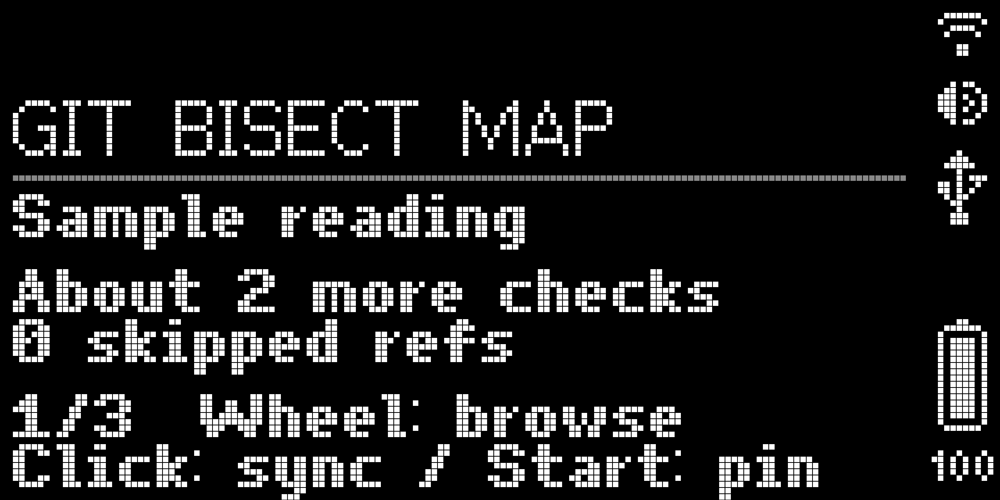

# Git Bisect Map

See the remaining revision range and good/bad bounds of a local Git bisect without changing it.

During a long test run, the bar can keep the remaining search range visible while your terminal is doing something else. The companion reads the bisect already running in your worktree.

## Screen transitions

Move from the remaining search range to the result of the next test.


<details>

<summary>Watch the rear display</summary>



</details>

## Read the remaining search range

1. Start a normal Git bisect in the repository you are investigating and identify good and bad bounds in your usual terminal.
2. Set the companion’s `repo` path to that worktree. **CANDIDATES** is the number of revisions reachable from the bad bound after excluding the good bounds.
3. Turn to **BAD BOUND** to see the abbreviated commit. The rear identifies the current checkout as well.


## Check progress after a test

1. Record your test verdict in Git. The companion leaves all refs and checkout decisions to that Git session.
2. Return to **CANDIDATES** and click to sync. The rear gives a rough count of remaining checks and any skipped refs.
3. Browse onward to **GOOD BOUND** if you need to check the starting side of the range.


## Example from the emulator

The test repository contained five commits and four candidate revisions. A balanced search suggests roughly two more checks for four candidates. Merges or skipped commits can change how many tests are actually needed. The companion read an active bisect in a local five-commit test repository.

## Set up the source

Set repo to a local working repository where a default-terms Git bisect is in progress. The companion uses only for-each-ref, rev-list and rev-parse. It counts commits reachable from the bad revision excluding all known good revisions. Unusual merge histories and skipped revisions can increase the actual number of steps.

## Connect the bar

Copy companion/example.json to a private config.json and adjust it for your source. From the project folder run `python3 companion/serve.py --config config.json`. Use Python 3.10+. Set Local companion URL to `http://127.0.0.1:8770/reading` on the emulator and allow local port 8770. On hardware, bind the companion to a trusted LAN interface and set its reachable address. The wheel browses pages. Click refreshes. Start pins or unpins the current page. The last good reading is labeled offline after a source error.

## Run in the emulator

Open BUSY Bar Emulator. From this repository, run:

```sh
~/.busy-emulator/bin/busy-emulator dev --once
```

Press **Back** to exit.

The GIFs are excerpts from the emulator recording. Each LED occupies a 16 × 16 cell with a black border. The end frames pause for reading.

[Full recording](media/controls.mp4) · [Rear display](screenshots/back-1.png) · [Firmware test](EMULATOR-QA.md) · [MIT license](LICENSE)
